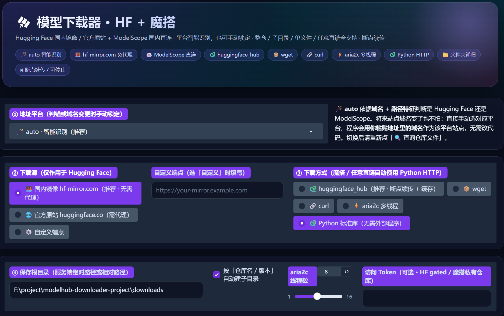
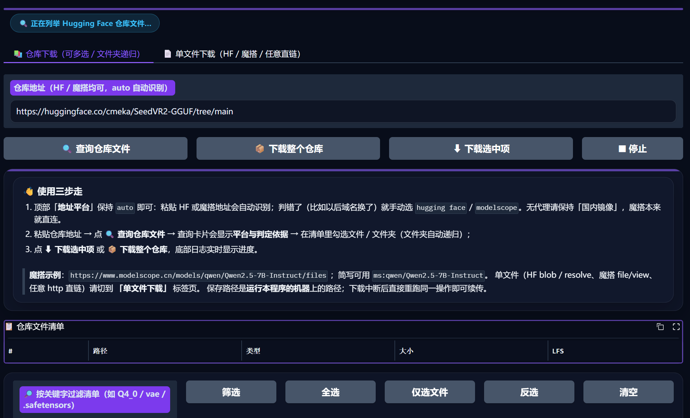
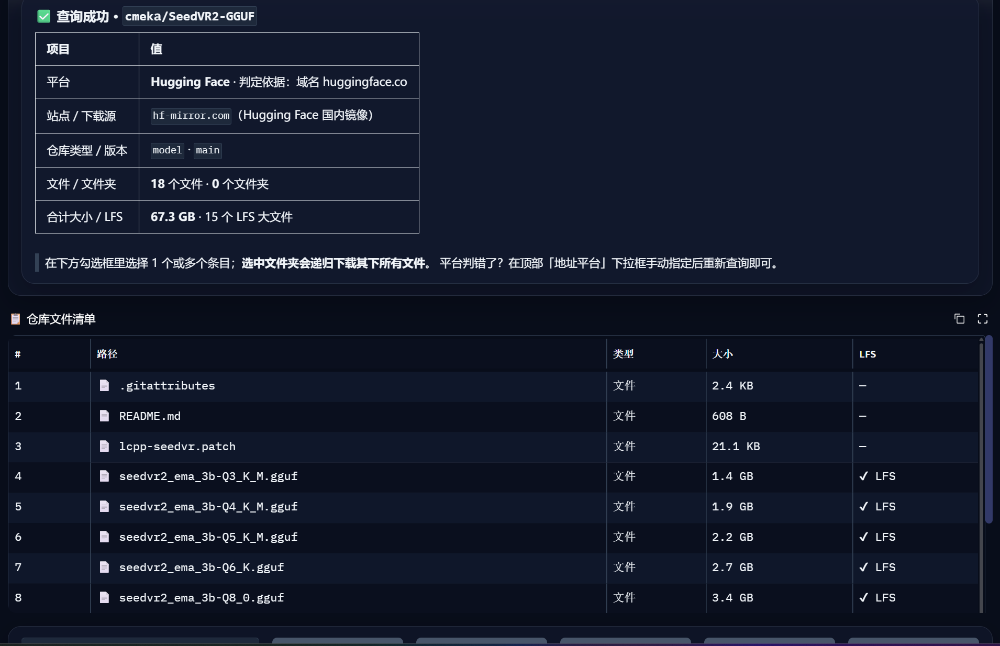
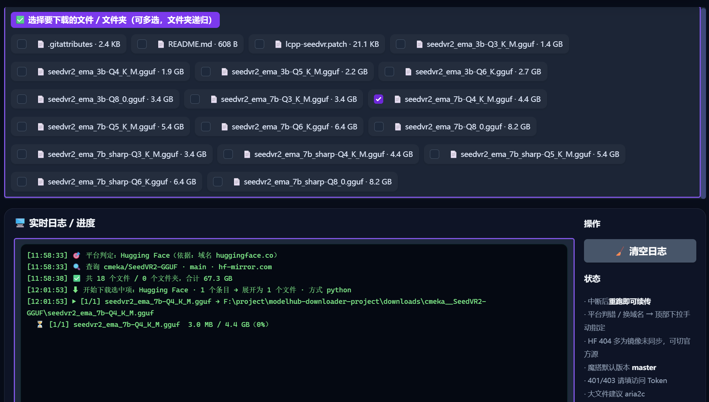

ModelHub Downloader is a lightweight, open-source web UI for browsing and downloading AI model files from Hugging Face and ModelScope. Built with Python and Gradio, it supports repository file listing, directory-aware selection, batch downloads, single-file downloads, progress logs, download cancellation, and multiple download backends. The Hugging Face edition supports the hf-mirror.com endpoint, the official Hugging Face Hub, and custom endpoints. The combined edition additionally supports ModelScope repositories and generic HTTP/HTTPS file URLs. All files are saved on the machine running the application.





## Features

- **Two standalone applications**
  - `hf_downloader.py`: Hugging Face repository and single-file downloader.
  - `modelhub_downloader.py`: combined Hugging Face + ModelScope + generic HTTP/HTTPS direct-link downloader.
- **Repository browsing**: query repository files, inspect paths and file sizes, filter by keywords, select individual files or directories, and recursively download selected directories.
- **Single-file downloads**: download a file from a supported repository URL or a generic HTTP/HTTPS direct link (combined edition).
- **Multiple download backends**
  - `huggingface_hub`: Hugging Face Hub-native download and cache support.
  - `python`: built-in Python standard-library HTTP downloader; no external executable required.
  - `wget`, `curl`, `aria2c`: optional external download tools. They must be installed and available in `PATH` before use.
- **Hugging Face endpoints**: hf-mirror.com, official `huggingface.co`, and a user-configured endpoint.
- **ModelScope support in the combined edition**: repository file listing through ModelScope REST API and file downloads through resolved file URLs; no ModelScope SDK is required by this project.
- **Operational controls**: progress/log display, stop control, retry handling, and resumable partial downloads where supported by the selected backend and server.
- **Access tokens**: optional token input for gated/private repositories where the platform supports token authentication.

## Project structure

```text
modelhub-downloader/
├── hf_downloader.py          # Hugging Face-only edition
├── modelhub_downloader.py    # Hugging Face + ModelScope + direct-link edition
├── requirements.txt
├── LICENSE
├── .gitignore
└── README.md
```

## Requirements

- Python 3.10 or later (Python 3.11 is recommended).
- Windows, Linux, and macOS should work where the selected Python packages and external download tools are supported.
- Required Python packages are listed in `requirements.txt`.
- `wget`, `curl`, and `aria2c` are optional system tools. They are not Python dependencies. Install only the tools you intend to use and ensure their executables are available in `PATH`.

## Installation

### 1. Clone the repository

```bash
git clone https://github.com/GongHuilin-DL/modelhub-downloader.git
cd modelhub-downloader
```

For Gitee, replace the clone URL with your Gitee repository URL.

### 2. Create and activate a virtual environment

Windows (PowerShell):

```powershell
python -m venv .venv
.\.venv\Scripts\Activate.ps1
```

Linux / macOS:

```bash
python3 -m venv .venv
source .venv/bin/activate
```

Or use Conda:

```bash
conda create -n modelhub-downloader python=3.11 -y
conda activate modelhub-downloader
```

### 3. Install Python dependencies

```bash
python -m pip install --upgrade pip
pip install -r requirements.txt
```

## Usage

### Hugging Face edition

```bash
python hf_downloader.py
```

Open `http://127.0.0.1:7860` in your browser.

This edition supports Hugging Face repositories and single-file URLs. The default endpoint is `https://hf-mirror.com`; you can switch to the official Hugging Face endpoint or configure a custom endpoint in the UI.

### Combined edition: Hugging Face + ModelScope + direct links

```bash
python modelhub_downloader.py
```

Open `http://127.0.0.1:7860` in your browser. Keep platform detection set to `auto` in normal use. If a URL is not recognized correctly, choose the platform manually in the UI.

Examples of supported address formats:

```text
# Hugging Face repository
https://huggingface.co/owner/repo/tree/main

# Hugging Face file
https://huggingface.co/owner/repo/blob/main/config.json

# ModelScope repository
https://www.modelscope.cn/models/owner/repo/files

# ModelScope file
https://www.modelscope.cn/models/owner/repo/file/view/master/config.json

# ModelScope shorthand
ms:owner/repo

# Generic HTTP/HTTPS direct file URL
https://example.com/path/to/model.safetensors
```

### Change the local listening port

Both scripts read the `HF_DL_PORT` environment variable. For example:

Windows PowerShell:

```powershell
$env:HF_DL_PORT="7861"
python modelhub_downloader.py
```

Linux / macOS:

```bash
HF_DL_PORT=7861 python modelhub_downloader.py
```

### Choose a download backend

| Backend | Description | Notes |
|---|---|---|
| `huggingface_hub` | Uses the official Hugging Face Python client | For Hugging Face repositories; supports Hub cache behavior. |
| `python` | Built-in Python standard-library HTTP downloader | No external executable required; used for ModelScope and generic direct links in the combined edition. |
| `wget` | Uses GNU Wget | Install Wget separately and ensure it is in `PATH`. |
| `curl` | Uses curl | Install curl separately and ensure it is in `PATH`. |
| `aria2c` | Uses aria2 for multi-connection downloads | Install aria2 separately; tune the connection count according to the server and network. |

The combined edition automatically falls back to the built-in Python HTTP downloader for ModelScope and generic direct links when the selected backend is not applicable. Resuming a partial download depends on server-side HTTP Range support and backend behavior; if a server does not support Range requests, the Python downloader restarts that file from the beginning.

## Authentication and access

- Public repositories generally do not require a token.
- Gated or private Hugging Face repositories may require a valid Hugging Face access token and prior approval/acceptance of the repository terms on the platform.
- Private ModelScope repositories may require a platform-supported access token.
- Never commit access tokens, passwords, cookies, or other credentials to Git. Do not paste tokens into screenshots or public issue reports.

## Download location

The save path configured in the UI is a path on the **machine running the Python application**, not necessarily the computer or browser displaying the UI. If the application is running on a remote server, downloaded files are stored on that server.

By default, downloads are placed in a `downloads/` directory under the current working directory. The UI can be used to change the save location.

## Important notes and limitations

1. This project is a download client, not a model host or mirror. Availability, access permissions, rate limits, and download speed are determined by the source platform, endpoint, network, and repository owner.
2. The Hugging Face mirror may not have synchronized every repository or revision. If a file is missing or returns 404 from the mirror, try the official endpoint or another supported endpoint.
3. ModelScope repository enumeration uses its web API. API behavior, pagination limits, authentication rules, and response formats may change; very large repositories can take longer to enumerate.
4. External download backends (`wget`, `curl`, `aria2c`) must be installed independently. The application checks whether the selected executable is available, but does not install it.
5. A successful HTTP response does not independently prove that a downloaded model is semantically valid. For critical artifacts, verify checksums or repository-provided integrity metadata when available.
6. The current implementation keeps application state in process memory and is intended for a single local user. It is not designed as a multi-user download service.
7. The application binds to `127.0.0.1` by default and does not enable Gradio public sharing. Do not expose it to an untrusted network without adding appropriate authentication, access controls, and deployment hardening.
8. Respect the model's license, usage restrictions, and the terms of service of Hugging Face, ModelScope, and any mirror or file host.

## Troubleshooting

- **`ModuleNotFoundError: gradio`**: activate the intended environment and run `pip install -r requirements.txt`.
- **Selected `wget` / `curl` / `aria2c` is unavailable**: install the corresponding executable and verify that it can be found from the same terminal/environment.
- **401 / 403**: check the token, repository visibility, access approval, and license/terms acceptance.
- **404 from the mirror**: the repository, branch, or file may not exist, or the mirror may not have synchronized it. Try the official endpoint.
- **Connection timeout / TLS errors**: check network access, proxy configuration, endpoint availability, and firewall rules.
- **Insufficient disk space / permission denied**: choose a writable directory with sufficient free space.
- **Port already in use**: set `HF_DL_PORT` to another available port.

## License

This project is released under the MIT License. See [LICENSE](LICENSE).

## Disclaimer

This project is provided for learning, research, and legitimate model distribution workflows. The authors are not responsible for third-party repository availability, content, licensing, or usage. Users are responsible for complying with applicable laws and platform policies.
